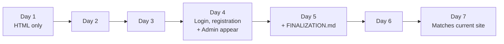

<div align="center">


> A full-stack local marketplace for browsing farm products and farmers, discovering recipes and meal kits, placing demo orders, and managing everything from a private admin dashboard.


</div>

---

## ✨ Features

### 🔐 Accounts and Sessions
- Create a customer account, sign in, and sign out.
- Every site page requires an account; AniMo always starts at the **sign-in page**.
- Passwords are hashed with **scrypt** and sessions use secure cookies.

### 🛒 Marketplace
- Browse **products, farmers, recipes, and meal kits**.
- Home page totals for farm products and local farms come from the **catalog API**.
- Demo checkout saves orders to the database (**no real payments**).

### 👤 Profiles
- Edit your profile name.
- Upload or remove a profile picture.

### 🛠️ Admin Dashboard
- Add, edit, and remove products, farmers, recipes, and meal kits.
- Upload listing photos.
- Update customer **order statuses**.
- Manage the help assistant's knowledge entries.

### 🤖 Help Assistant
- Answers questions using built-in help plus **enabled admin-managed entries**, matched by topic.
- Fully local: **no external AI service is configured or called**.

---

## 🚀 Getting Started

### Requirements
- **Node.js 22.13+** (needs the built-in `node:sqlite` module)
- A modern browser (Chrome, Edge, Firefox, Safari)
- ✅ No npm packages. Nothing to `npm install`.

### Run the app

**1.** Open a terminal in the project folder and set a private admin username and a password of **12+ characters**.

<details open>
<summary><b>🪟 Windows (PowerShell)</b></summary>

```powershell
$env:ANIMO_ADMIN_USERNAME = "your-admin-name"
$env:ANIMO_ADMIN_PASSWORD = "use-a-long-private-password"
node server.js
```

</details>

<details>
<summary><b>🍎 macOS / 🐧 Linux</b></summary>

```bash
export ANIMO_ADMIN_USERNAME="your-admin-name"
export ANIMO_ADMIN_PASSWORD="use-a-long-private-password"
node server.js
```

</details>

**2.** Open **http://127.0.0.1:8000** (or `/pages/login/login.html`).

**3.** Create a customer account, or click **"Administrator? Sign in to the admin dashboard"** and use your admin credentials.

**4.** Stop the server with **Ctrl+C**.

> **Tip:** Never open `index.html` directly as a `file://` URL. Login, logout, profiles, and the database APIs all need the Node.js server running.

<details>
<summary><b>🔁 Already initialized the database without admin settings?</b></summary>

Set both environment variables and restart. The admin account is created on startup. If that username was previously registered as a customer, pick a different admin username.

</details>

---

## 📸 Screenshots

<!-- Replace these with your real screenshots. -->

| Home | Marketplace |
|------|-------------|
|  |  |

| Profile | Admin Dashboard |
|---------|-----------------|
|  |  |

---

### 📁 Project Structure

```text
AniMo/
├── server.js               # Node.js server (site, APIs, auth)
├── admin/                  # Private administrator dashboard
│   ├── index.html
│   ├── admin.css
│   └── admin.js
├── pages/                  # Site pages (e.g. pages/login/login.html)
├── shared/assets/          # Listing photos (by category) and profiles/
├── data/                   # SQLite databases (created on first run)
└── development-days/       # Seven learning snapshots (Day 1 → Day 7)
```

---

## 💾 Data Storage

The server creates three separate databases in `data/`:

| File | Contents |
|------|----------|
| `users.sqlite` | Usernames, scrypt password hashes, sessions, profile names and picture paths, orders |
| `listings.sqlite` | Products, farmers, recipes, meal kits, image paths (demo records load on first creation) |
| `ai.sqlite` | Assistant knowledge entries (storage only) |

- SQLite may also create `*.sqlite-shm` and `*.sqlite-wal` files while running. This is normal.
- **Back up** by stopping the server, then copying the whole `data/` folder.
- ⚠️ `data/` contains personal order information. **Keep it private and out of Git.**

---

## 🛠️ Admin Dashboard

Sign in with the configured admin account and open **`/admin/`**.

| Tool | What you can do |
|------|-----------------|
| 📦 Listings | Add, edit, and remove products, farmers, recipes, and meal kits |
| 📷 Photos | Upload listing photos (saved under `shared/assets/` by category) |
| 🧾 Orders | Change customer order statuses |
| 🤖 Assistant | Add, edit, enable, or remove knowledge entries |

Customer profile pictures are managed by users on their own profile page and saved in `shared/assets/profiles/`.

---

## 🏗️ Tech Stack

- **Backend:** Node.js (built-in HTTP server, `node:sqlite`)
- **Frontend:** HTML, CSS, Vanilla JavaScript
- **Data Storage:** SQLite (`users.sqlite`, `listings.sqlite`, `ai.sqlite`)
- **Auth:** scrypt password hashing, hashed session tokens in `HttpOnly` cookies

---

## 🔐 Security Notes

- Passwords are **hashed**, not reversibly encrypted, with a random salt per user.
- The server binds only to `127.0.0.1` and is meant for **local development and demos**.
- 🚫 **Do not expose this server to the internet.** A public deployment needs HTTPS, secure hosting, backups, monitoring, production-grade rate limiting, and a reviewed security setup.
- Checkout records demo orders and **does not process payments**.

---

## 📚 Seven-Day Learning Snapshots

The `development-days/` folder shows the project growing from HTML-only to the current connected local app.



- Each snapshot has its own `README.md` with launch steps and intentionally unfinished areas.
- Each Node-backed copy creates **its own databases** on first run.
- These are educational versions, **not production deployments**.

---

## 🧯 Troubleshooting

| Problem | Fix |
|---------|-----|
| `Cannot find module 'node:sqlite'` | Upgrade to Node.js 22.13 or newer |
| Login or profile pages don't work | Use `http://127.0.0.1:8000`, not a `file://` path |
| Can't sign in as admin | Set both env variables in the same terminal before `node server.js`; password must be 12+ characters |
| Admin username rejected | It may already be a customer account; choose another |
| Port 8000 in use | Stop the other process, then restart |

---

## 🙌 Git Hygiene

Keep local databases out of the repo by adding this to `.gitignore`:

```gitignore
data/
*.sqlite
*.sqlite-shm
*.sqlite-wal
```

If they are already tracked, untrack them while keeping your local copies:

```bash
git rm -r --cached data/
git commit -m "Stop tracking local databases"
```

> Files pushed earlier remain in Git history even after deletion.

---

## 👥 Team

<table>
  <tr>
    <td align="center">
      <a href="https://github.com/Rjay29">
        
      </a>
      <br />
      <sub><b>Arazula, Rjay D.</b></sub>
      <br />
      <sub><b>Your Role Here</b></sub>
      <br />
      <a href="https://github.com/Rjay29">
        
      </a>
    </td>
    <td align="center">
      <a href="https://github.com/LazyAustin525">
        
      </a>
      <br />
      <sub><b>Apolinar, Jev Austin A.</b></sub>
      <br />
      <sub><b>Your Role Here</b></sub>
      <br />
      <a href="https://github.com/LazyAustin525">
        
      </a>
    </td>
    <td align="center">
      <a href="https://github.com/Nicojin">
        
      </a>
      <br />
      <sub><b>Fernandez, John Rommel P.</b></sub>
      <br />
      <sub><b>Your Role Here</b></sub>
      <br />
      <a href="https://github.com/Nicojin">
        
      </a>
    </td>
  </tr>
</table>

---

## 📝 Notes

> AniMo is a learning project built to demonstrate a connected full-stack web app (authentication, databases, and an admin dashboard) without external dependencies.
