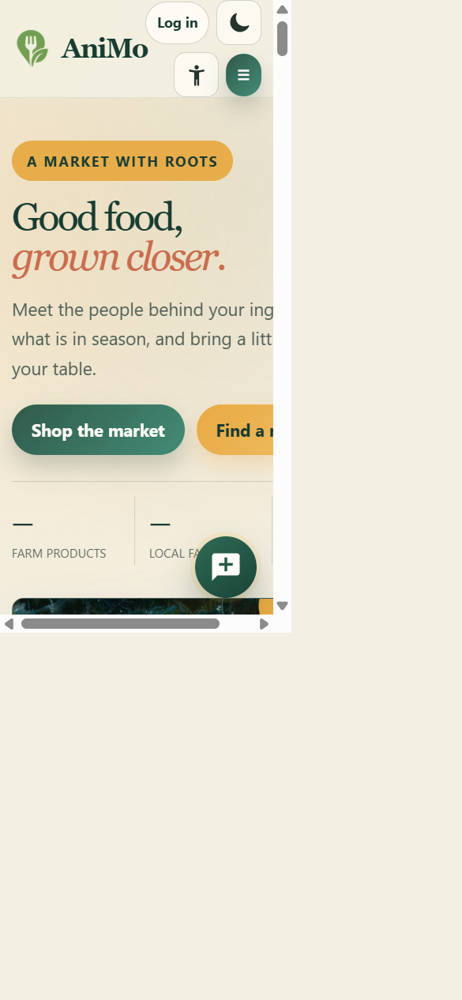
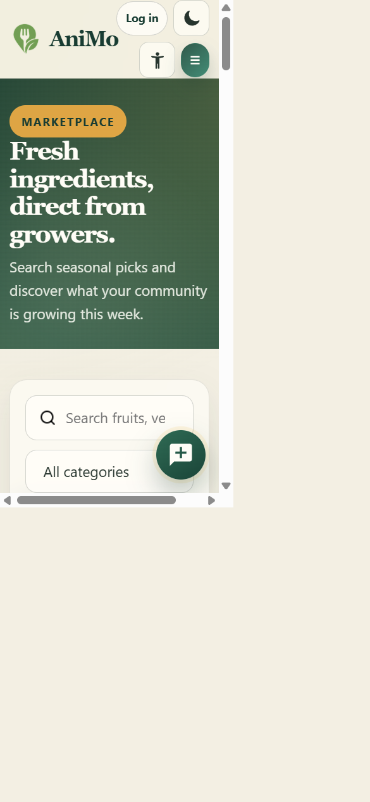
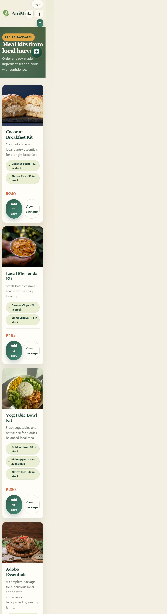
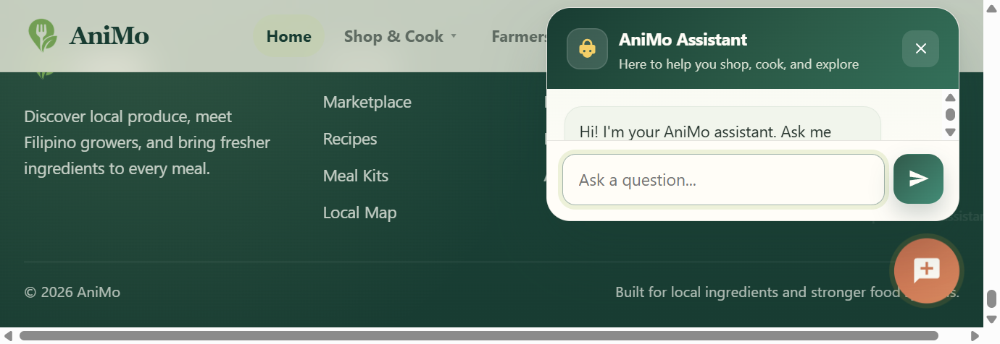

<div align="center">


# AniMo local marketplace demo

> A full-stack local marketplace for browsing farm products and farmers, discovering recipes and meal kits, placing demo orders, and managing everything from a private admin dashboard.

> Note: the logo is not finished yet.


</div>

---

## About

AniMo is a responsive Filipino farm-marketplace demo built with HTML, CSS, browser JavaScript, Node.js, and built-in SQLite. Visitors can browse the public catalog without signing in; checkout, profile/order actions, chats, and farmer tools require the appropriate account.

---

## Accounts and demo flows

- **Guest:** opening `http://127.0.0.1:8000` goes straight to AniMo Home. Anyone can browse products, farmers, recipes, meal kits, and the local map. Opening the cart, checkout, profile, chat, or farmer dashboard redirects to the sign-in page first.
- **Buyer:** browse listings, register with name, username, profile picture, email or Philippine mobile, verify the on-page demo OTP, accept the terms, then sign in.
- **Farmer:** choose Farmer during registration and submit farm details, a government ID, proof of address, bank proof, and (for groups) DA accreditation. Documents are stored under private `data\farmer-documents\`; an admin must approve the application before the farmer can sign in.
- **Farmer dashboard:** create product/recipe/meal-kit submissions, edit stock/listings, manage order delivery, and chat. New submissions remain hidden until an admin approves them.
- **Admin:** review farmer documents and listing submissions, manage catalog records and order delivery, and edit assistant help data.
- **Profiles:** signed-in users can edit their profile name, upload or remove a profile picture, and see their orders.

The local OTP is intentionally displayed in the browser; it is not sent by email or SMS. Seeded buyer reviews are labeled demo reviews. Listing ratings, delivered-order reviews, and order counts use local demo data.

The first server start seeds 25 additional Philippine farmer profiles, 155 product listings, 20 recipes, 15 meal kits, demo comments for the added listings, and AniMo assistant FAQ records. Seeding is idempotent. The `jev`/`austin` demo chat is associated with five existing completed cassava orders when those accounts and orders are present.

### Local implementation boundaries

- Checkout records orders and supports COD, BPI/BDO transfer, and InstaPay/e-wallet **as labels only**. No bank, e-wallet, or payment provider is contacted.
- The Home local map uses Leaflet, OpenStreetMap tiles, Nominatim geocoding, and OSRM road routes. Map searches, seller pins, current location, and directions are limited to Philippine bounds. Public map services require an internet connection and are subject to their usage policies; this is not a courier booking or delivery guarantee. No map API key is needed.
- Farmer document approval is a manual local workflow. There is no government-ID, DA, bank, or address validation service.
- Email/phone OTP, delivery tracking, SMS/email messages, and chats are local demos; chats refresh by polling.
- This is not a production deployment. Production use needs HTTPS, external provider integrations, legal/privacy review, hardened operational rate limiting, backups, audit/retention policy for sensitive documents, and deployment security review.

---

## How to run

### Requirements

- **Node.js 22.13+** (needs the built-in `node:sqlite` module)
- A modern browser (Chrome, Edge, Firefox, Safari)
- ✅ No npm packages. Nothing to `npm install`.
- Optional: [Ollama](https://ollama.com) for free-form assistant answers (see [Optional generative assistant](#optional-generative-assistant)).

### Start the server

**1.** Open a terminal in the project folder and set a private admin username and a password of **12+ characters**.

<details open>
<summary><b>🪟 Windows (PowerShell)</b></summary>

```powershell
$env:ANIMO_ADMIN_USERNAME = "your-admin-name"
$env:ANIMO_ADMIN_PASSWORD = "use-a-long-private-password"
node server.js
```

</details>

<details>
<summary><b>🍎 macOS / 🐧 Linux</b></summary>

```bash
export ANIMO_ADMIN_USERNAME="your-admin-name"
export ANIMO_ADMIN_PASSWORD="use-a-long-private-password"
node server.js
```

</details>

The admin variables are optional for browsing, but without them there is no administrator account.

**2.** Open **http://127.0.0.1:8000**. The server starts at AniMo Home.

**3.** To use the admin dashboard, copy the private administrator URL printed in the terminal:

```text
Private administrator sign-in: http://127.0.0.1:8000/control/<random code>
```

Open it and sign in with the configured admin credentials. The URL changes every time the server restarts. Do not expose the development server to the internet.

**4.** Stop the server with **Ctrl+C**.

> **Tip:** Never open `index.html` or any page directly as a `file://` URL. Login, profiles, the catalog, and all database APIs need the Node.js server running.

<details>
<summary><b>🔁 Already initialized the database without admin settings?</b></summary>

Set both environment variables and restart. The admin account is created on startup. If that username was previously registered as a customer, pick a different admin username. If the admin account already exists, restarting with a different `ANIMO_ADMIN_PASSWORD` does **not** change its password.

</details>

### Optional generative assistant

The assistant always has local AniMo catalog/help responses and exact-match Assistant Data answers. For free-form generated answers, install Ollama, download a local model, and run the Ollama service:

```powershell
ollama pull llama3.1
ollama serve
```

By default the server calls `http://127.0.0.1:11434` using model `llama3.1`. Override these with `OLLAMA_URL` and `OLLAMA_MODEL` before starting `node server.js`. No cloud AI credentials are required or sent. If Ollama is not running, the server still starts and the assistant uses its local answers.

### Environment variables

| Variable | Default | Purpose |
|----------|---------|---------|
| `ANIMO_ADMIN_USERNAME` | (none) | Administrator username (3–32 letters, numbers, `.`, `_`, `-`) |
| `ANIMO_ADMIN_PASSWORD` | (none) | Administrator password, 12+ characters |
| `PORT` | `8000` | Server port (always bound to `127.0.0.1`) |
| `OLLAMA_URL` | `http://127.0.0.1:11434` | Local Ollama service for the assistant |
| `OLLAMA_MODEL` | `llama3.1` | Ollama model name |

Set these in the terminal before `node server.js`. The server does not read a `.env` file.

---

## 📸 Screenshots

| Home (mobile) | Marketplace (mobile) | Meal kits (tablet) |
|---------------|----------------------|--------------------|
|  |  |  |

| AniMo Assistant |
|-----------------|
|  |

More layout screenshots are in [`files/`](files/).

---

## 📁 Project Structure

```text
AniMo/
├── server.js               # Node.js server: pages, APIs, auth, OTP, maps, assistant, seeding
├── index.html              # Redirects to AniMo Home
├── admin/                  # Administrator dashboard (served only at the private /control/<code> URL)
│   ├── index.html
│   ├── admin.css
│   └── admin.js
├── pages/                  # Site pages, one folder each (html/css/js):
│                           #   home, marketplace, product-details, farmers, farmer-profile,
│                           #   recipe-discovery, recipe-details, recipe-packages, package-details,
│                           #   cart, checkout, login, register, profile, about, farmer-dashboard
├── shared/
│   ├── css/                # Global styles, components, navbar, footer
│   ├── js/                 # API client, cart, navigation + assistant, reviews, theme, catalog data
│   └── assets/             # Logo, icons, and listing/profile photos by category
├── data/                   # SQLite databases, demo seed data, farmer documents (private)
├── files/                  # Layout screenshots
└── development-days/       # Learning snapshots from HTML-only to the connected app
```

---

## 💾 Data Storage

The server creates three separate databases in `data/`:

| File | Contents |
|------|----------|
| `users.sqlite` | Accounts (scrypt password hashes), profiles (name, picture, contact, account type), sessions, OTP challenges, farmer applications, orders (payment label, delivery coordinates), chats, and reviews |
| `listings.sqlite` | Products, farmers, recipes, meal kits, image paths, listing owner and review status, seed settings |
| `ai.sqlite` | Assistant knowledge entries and cached map search locations |

Also in `data/`:

- `farmer-documents/`: farmer verification files (government ID, proof of address, bank proof, DA accreditation). These stay outside the static asset tree and are only served to the admin.
- `catalog-image-map.json` and `expanded-demo-data.js`: demo catalog seed data.

Notes:

- SQLite may also create `*.sqlite-shm` and `*.sqlite-wal` files while running. This is normal.
- **Back up** by stopping the server, then copying the whole `data/` folder.
- ⚠️ `data/` contains personal information (orders, contacts, farmer documents). **Keep it private.**

Uploaded catalog/profile images are validated and saved as files beneath their matching `shared\assets\` subfolders. Existing local visuals are organized under `shared\assets\`: brand/profile photos at the root and categorized `icons\`, `marketplace\`, `farmers\`, `recipes\`, and `meal_kits\` folders. The Home map loads Leaflet from unpkg and map data/tiles from OpenStreetMap-compatible services; these are the only required third-party map assets/services.

---

## 🛠️ Admin Dashboard

Start the server with the admin variables set, open the **private administrator URL printed in the terminal** (`/control/<random code>`), and sign in. The old `/admin/` address no longer works.

| Tool | What you can do |
|------|-----------------|
| 📦 Listings | Add, edit, and remove products, farmers, recipes, and meal kits; upload listing photos |
| ✅ Listing review | Approve or reject listings submitted by farmers |
| 🧑‍🌾 Farmer applications | Review farmer details and documents, then approve or reject the application |
| 🧾 Orders | Change order and delivery status |
| 🤖 Assistant data | Add, edit, enable, or remove the assistant's knowledge entries |

Customer profile pictures are managed by users on their own profile page and saved in `shared/assets/profiles/`.

---

## 🏗️ Tech Stack

- **Backend:** Node.js (built-in HTTP server, `node:sqlite`, `node:crypto`), no npm packages
- **Frontend:** HTML, CSS, Vanilla JavaScript
- **Data Storage:** SQLite (`users.sqlite`, `listings.sqlite`, `ai.sqlite`)
- **Auth:** scrypt password hashing, hashed session tokens in `HttpOnly` cookies, local demo OTP
- **Maps:** Leaflet with OpenStreetMap tiles, Nominatim geocoding, and OSRM routing (no API key)
- **Assistant:** local knowledge answers, optional local [Ollama](https://ollama.com) model

---

## Security Notes

- Passwords are **hashed**, not reversibly encrypted, with a random salt per user.
- Repeated failed sign-ins are temporarily locked out.
- The admin dashboard is only reachable through a random `/control/<code>` URL that changes on every restart, and only for the administrator account.
- Farmer verification documents are kept in `data/farmer-documents/` and are only served to the admin.
- The server binds only to `127.0.0.1` and is meant for **local development and demos**.
- 🚫 **Do not expose this server to the internet.** A public deployment needs HTTPS, secure hosting, backups, monitoring, production-grade rate limiting, and a reviewed security setup.
- Checkout records demo orders and **does not process payments**.

---

## Troubleshooting

| Problem | Fix |
|---------|-----|
| `Cannot find module 'node:sqlite'` | Upgrade to Node.js 22.13 or newer |
| Login or profile pages don't work | Use `http://127.0.0.1:8000`, not a `file://` path |
| Can't find the admin dashboard | Use the `Private administrator sign-in` URL printed in the terminal; `/admin/` is no longer used |
| Admin URL stopped working | It changes on every restart; copy the new one from the terminal |
| Can't sign in as admin | Set both env variables in the same terminal before `node server.js`; password must be 12+ characters |
| Server stops with an admin username error | That username already belongs to a customer account; choose another |
| Farmer can't sign in | An admin must approve the farmer application first |
| Assistant only gives short built-in answers | Ollama isn't running or the model isn't installed; run `ollama pull llama3.1` and `ollama serve` (optional) |
| Map is blank or search fails | The map needs an internet connection for OpenStreetMap tiles, search, and routes |
| Port 8000 in use | Stop the other process, or set `PORT` to another number, then restart |

---

## Git Hygiene

- `.env` is listed in `.gitignore`, so local settings files are not committed. Check with `git check-ignore .env`.
- `.gitignore` also lists `data/*.sqlite`, `*.sqlite-shm`, and `*.sqlite-wal`, but the database files are **still tracked** in Git for now, so running the server shows them as modified. Ignore rules don't apply to files Git already tracks.
- The databases contain password hashes, sessions, contacts, and orders. The team should decide whether to untrack them (`git rm --cached`, which keeps local copies). Files pushed earlier remain in Git history even after untracking.
- Until then, don't commit database changes from local testing. Restore them with `git restore data/` after stopping the server.
- Add files by name instead of `git add .`.

---

## Development snapshots

The `development-days\` directory contains the project's learning snapshots, from HTML-only through the locally connected application. Each snapshot's README records its intended stage and run instructions; snapshots are educational copies and may not include current demo features. Each Node-backed snapshot creates **its own databases** on first run.

---

## Team

<table>
  <tr>
    <td align="center">
      <a href="https://github.com/Rjay29">
        
      </a>
      <br />
      <sub><b>Arazula, Rjay D.</b></sub>
      <br />
      <br />
      <a href="https://github.com/Rjay29">
        
      </a>
    </td>
    <td align="center">
      <a href="https://github.com/LazyAustin525">
        
      </a>
      <br />
      <sub><b>Apolinar, Jev Austin A.</b></sub>
      <br />
      <br />
      <a href="https://github.com/LazyAustin525">
        
      </a>
    </td>
    <td align="center">
      <a href="https://github.com/Nicojin">
        
      </a>
      <br />
      <sub><b>Fernandez, John Rommel P.</b></sub>
      <br />
      <br />
      <a href="https://github.com/Nicojin">
        
      </a>
    </td>
  </tr>
</table>

---

## 📝 Notes

> AniMo is a learning project built to demonstrate a connected full-stack web app (authentication, databases, and an admin dashboard) with no npm dependencies. The only outside services are the public OpenStreetMap map services and, optionally, a local Ollama model.
